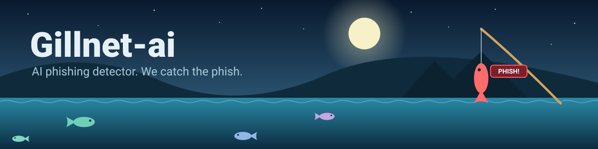

# Gillnet-ai

AI phishing detector with a fishing-themed web UI. Paste a URL or a whole email, Gillnet-ai casts a line, and if it's phishing, you'll see the phish get reeled in.



## Demo


## Run

```bash
pip install -r requirements.txt
python gillnet.py train --data your_dataset.csv   # columns: url,label (1=phish, 0=legit)
python app.py                                    # then open http://127.0.0.1:5000
```

Without a trained model, `app.py` falls back to the synthetic `sample_data.csv` (demo only).

## CLI

```bash
python gillnet.py predict "http://paypa1-secure-login.xyz/verify"
```

## How it works

Random Forest on ~23 URL features + char n-gram logistic regression, probabilities averaged.
Emails: links are extracted and scored; wording cues (urgency, "verify your account"...) add a simple heuristic.

## Notes

- `sample_data.csv` is **synthetic demo data** so the pipeline runs out of the box. Scores from it are not real accuracy.
  Train on real data (e.g. PhishTank/OpenPhish for phishing URLs, Tranco top sites for legit) and report real precision/recall.
- Email mode extracts links and adds a simple wording heuristic; a trained text classifier is planned.
